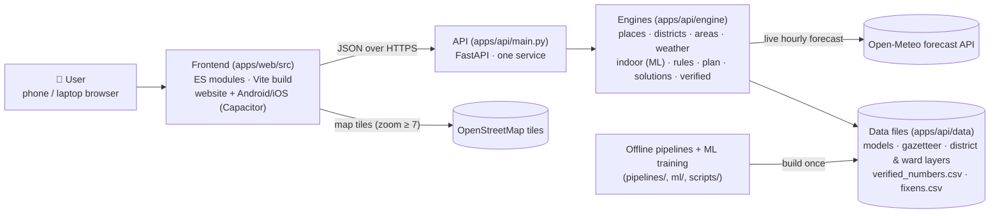
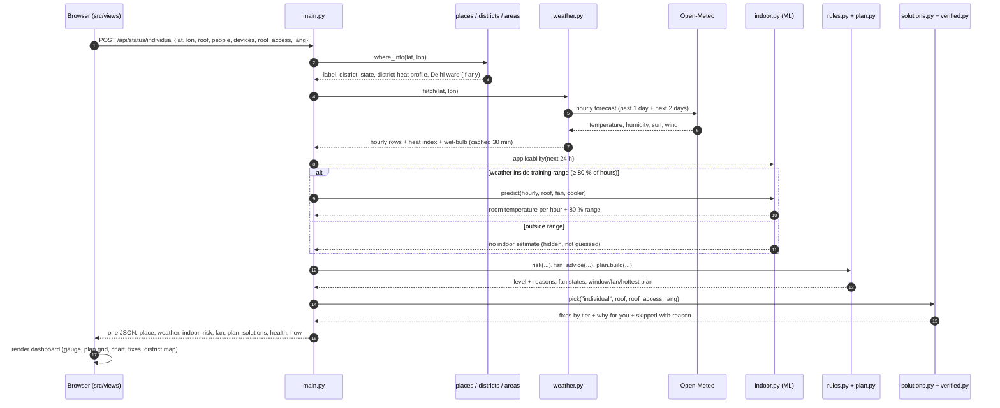
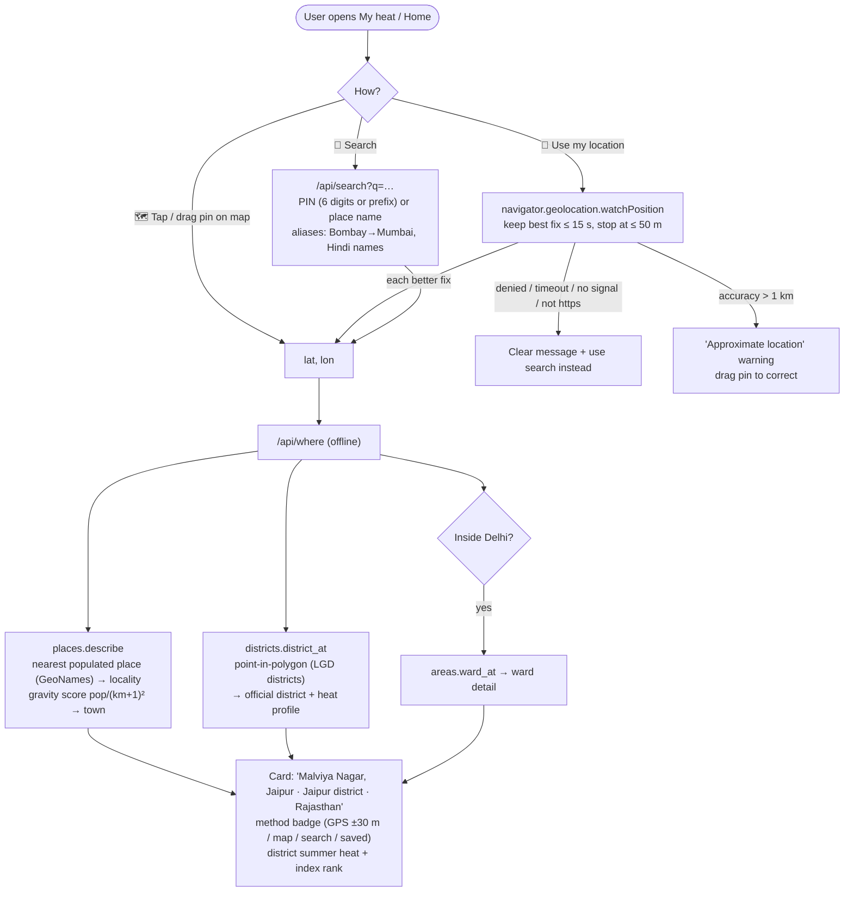
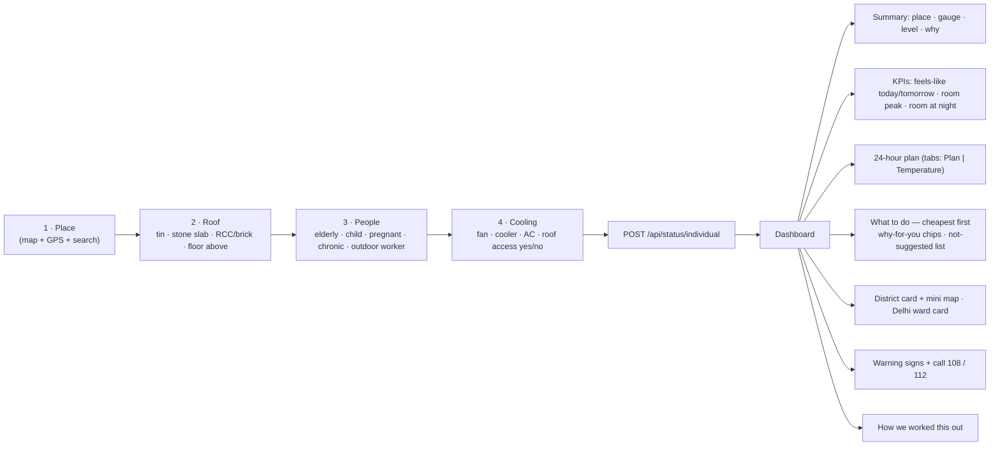
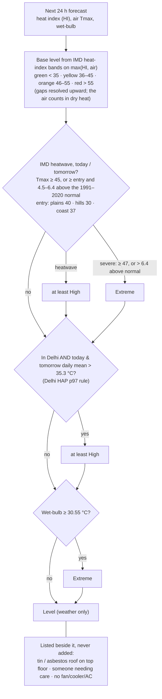
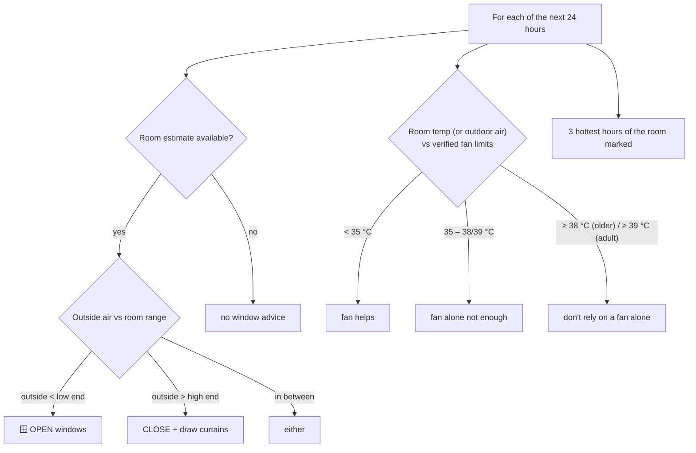
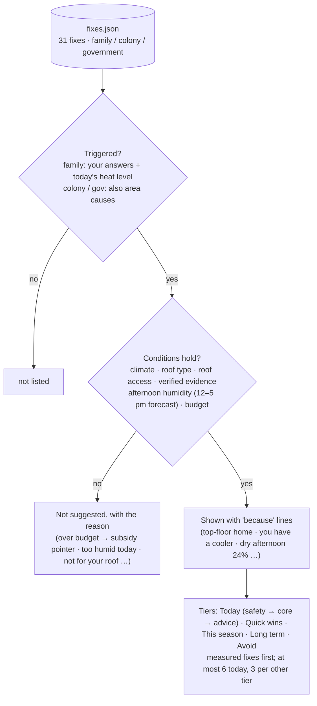
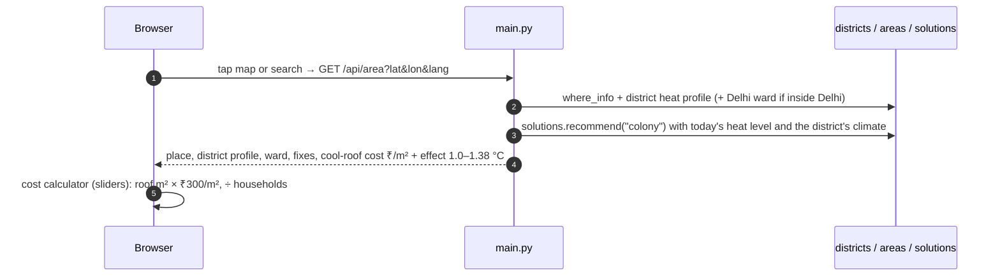
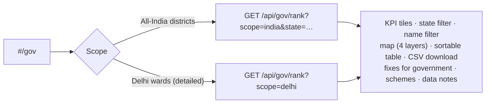
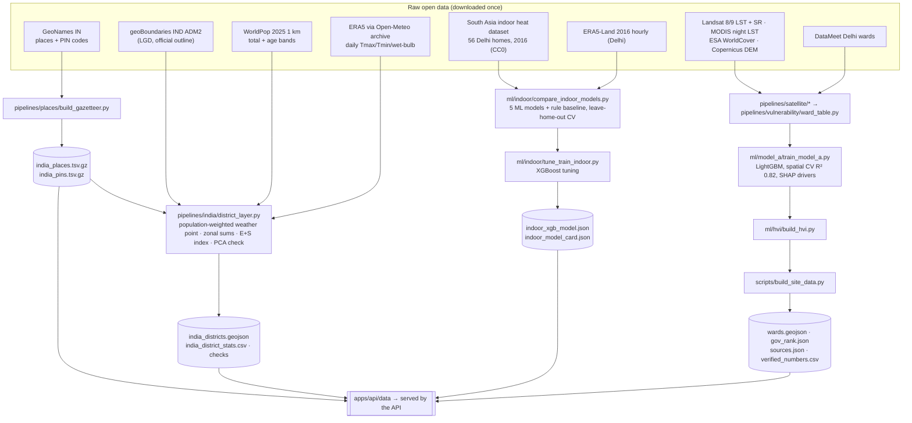

# Thandak: how the whole app works

**What it is:** a mobile-first website.
- **For anyone in India:** it gives their **heat level right now**, an **hour-by-hour plan for their home**, and **only evidence-backed fixes**, cheapest first.
- **For colonies and governments:** it gives the same for their area, plus a district ranking.
- **Languages:** Hindi and English.

**Design rule:**
- **ML predicts temperatures.** It never decides safety.
- **Published rules decide safety.**
- **Every number comes from a source.** Each one is in `verified_numbers.csv`.
- **The AI layer is a future add-on.** It may explain the plan in plain language, but it never changes a number.

> A visual version of this document (with all diagrams drawn, works offline) is in [`architecture.html`](architecture.html).

---

## Contents
1. [The big picture](#1-the-big-picture)
2. [Folder structure](#2-folder-structure)
3. [Runtime: one request, end to end](#3-runtime-one-request-end-to-end)
4. [Flow A: finding your place](#4-flow-a-finding-your-place)
5. [Flow B: personal heat check (My heat)](#5-flow-b-personal-heat-check-my-heat)
6. [The decision logic](#6-the-decision-logic)
7. [Flow C: Colony page](#7-flow-c-colony-page)
8. [Flow D: Government page](#8-flow-d-government-page)
9. [Offline pipelines and ML training](#9-offline-pipelines-and-ml-training)
10. [Frontend: pages, components, state](#10-frontend-pages-components-state)
11. [API reference](#11-api-reference)
12. [Data files the server loads](#12-data-files-the-server-loads)
13. [Run, test, deploy](#13-run-test-deploy)
14. [Honest limits](#14-honest-limits)

---

## 1. The big picture



| Layer | What it does | Key files |
|---|---|---|
| **Frontend** | Pages, maps, forms, language and theme. Built with Vite: about 35 KB gzipped to open; each screen, the Hindi strings and MapLibre (bundled, ~300 KB gzipped) load only when needed. The same build runs as the Android / iOS app through Capacitor. | `apps/web/src/*` |
| **API** | One FastAPI app. It serves the JSON endpoints **and** the static frontend. | `apps/api/main.py` |
| **Engines** | All logic: naming places, weather, the ML indoor model, safety rules, the plan and fix selection. | `apps/api/engine/*.py` |
| **Data** | Pre-built files: models, gazetteer, district and ward layers, verified numbers. | `apps/api/data/*` |
| **Pipelines / ML** | Run offline to download raw data, train models and build the data files. | `pipelines/`, `ml/`, `scripts/` |
| **External (runtime)** | Live forecast (Open-Meteo), base map tiles (OSM). Fonts and the map library are bundled, not loaded from a CDN. | none |

**Privacy:** place names and PIN search come from an **offline gazetteer** on our own server. The user's location is **never sent to a third-party geocoder**. The forecast request carries only the coordinates rounded to 0.01°.

---

## 2. Folder structure

```text
heat-india/
├── apps/
│   ├── api/                         ← the running service
│   │   ├── main.py                  FastAPI app: all /api/* endpoints + serves apps/web
│   │   ├── run_local.py             local runner (uvicorn)
│   │   ├── requirements.txt         fastapi, uvicorn, pydantic, numpy, xgboost, shapely
│   │   ├── engine/
│   │   │   ├── places.py            offline gazetteer: name any point in India, PIN/place search
│   │   │   ├── districts.py         all-India district polygons + heat/people index lookup
│   │   │   ├── areas.py             Delhi ward polygons (extra detail inside Delhi)
│   │   │   ├── weather.py           Open-Meteo forecast (past 24 h + next 48 h), 30-min cache
│   │   │   ├── heat.py              heat index (NWS Rothfusz) + wet-bulb (Stull 2011)
│   │   │   ├── indoor.py            ML: XGBoost room-temperature model + training-range check
│   │   │   ├── rules.py             heat level (IMD bands, heat-wave, wet-bulb) + fan limits
│   │   │   ├── plan.py              24-hour plan: windows / fan / hottest hours
│   │   │   ├── solutions.py         fix catalogue filter: why-for-you + skipped + cost tiers
│   │   │   └── verified.py          reads verified_numbers.csv (single source of truth)
│   │   └── data/                    files loaded at runtime (see section 12)
│   └── web/                         ← website + Android / iOS app (one codebase)
│       ├── index.html               app shell: top bar, tabs, bottom nav, footer
│       ├── vite.config.js           website build (dist/) and app build (dist-app/, bundles the map outlines)
│       ├── capacitor.config.json    native app id, splash, status bar
│       ├── android/, ios/           native projects (Capacitor)
│       └── src/
│           ├── main.js              entry: fonts, styles, shell (nav, language, theme), boot
│           ├── router.js            hash routes; each view is a lazily loaded chunk
│           ├── views/               landing · home · check (questions + result) · area · gov · info · parts
│           ├── api.js               server address, timeouts, short cache, shared in-flight requests
│           ├── native.js            location, CSV share sheet, back button, status bar (web vs app)
│           ├── map.js · place.js    MapLibre maps; place card, search box, GPS button
│           ├── ui.js · util.js      render, page header, cards, motion; small helpers
│           ├── styles.css           design system (light/dark)
│           ├── icons.js · art.js    inline SVG icons, roof illustrations, matka mascot and clouds
│           └── i18n/                en.js, hi.js (Hindi loads only when chosen)
├── pipelines/                       ← offline data builders
│   ├── places/build_gazetteer.py    GeoNames → india_places / india_pins
│   ├── india/district_layer.py      ERA5 summers + WorldPop + LGD districts → district index
│   ├── weather/                     historical weather for Delhi (validation, p97)
│   ├── satellite/                   Landsat LST, MODIS night LST, WorldCover, NDVI/NDBI/albedo (Delhi)
│   ├── vulnerability/               Delhi ward table + district priors
│   └── common/heat_formulas.py      shared formulas
├── ml/                              ← model training + model cards
│   ├── indoor/                      indoor model: compare 5 ML models + rules → tune XGBoost → card
│   ├── model_a/                     Delhi ground-heat model (LightGBM) + SHAP ward drivers
│   ├── hvi/                         Delhi ward heat-vulnerability index
│   └── phase0/                      dataset checks (roof offsets, Census roof shares)
├── scripts/build_site_data.py       copies models/cards → apps/api/data, builds wards.geojson etc.
├── tests/                           18 tests: formulas, rules, India features, plan, fixes
├── docs/                            this file, decisions, sources, phase reports, verified numbers
└── Dockerfile                       one container: API + website
```

---

## 3. Runtime: one request, end to end



---

## 4. Flow A: finding your place



**Notes**
- A **saved place** is labelled "Saved from your last visit". It is never presented as "just detected".
- **No PIN is shown for a GPS point.** GeoNames postal points are unreliable inside cities. PIN codes are used for search only, and are labelled "approximate area".

---

## 5. Flow B: personal heat check (My heat)



Answers are saved in the browser (`localStorage`). If the network fails, the last result is shown, marked "offline".

---

## 6. The decision logic

### 6.1 Heat level (rules, not ML)



Normals: `data/district_normals.json`, built by `pipelines/india/district_normals.py` from IMD's 1° gridded daily Tmax (1991–2020), bilinear to each district point and lapse-corrected for height (−6.5 °C/km). Hill = ground ≥ 1000 m, coast = within 30 km of the sea (design choices; IMD publishes no operational definition).

### 6.2 Room temperature (the ML part)

| | |
|---|---|
| **Model** | XGBoost regressor (`ml/indoor/`, served by `engine/indoor.py`) |
| **Trained on** | 94,955 hourly readings from 56 measured Delhi homes, Apr–Jun 2016 (open CC0 dataset) |
| **Inputs (21)** | Outdoor temperature, humidity, sun and wind.<br/>Lags (1–24 h), 24 h mean and max, 6 h sun total.<br/>Hour of day (sin/cos).<br/>Fan and cooler.<br/>Roof type (4 one-hot). |
| **Output** | Room temperature for each of the next 24 hours, shown as an 80 % range (pred − 2.21 to pred + 2.68 °C). |
| **Tested** | Leave-home-out cross-validation.<br/>MAE **1.52 °C**, against **2.11 °C** for a simple rule baseline.<br/>5 ML models and a rule baseline were compared before choosing XGBoost. |
| **Guard** | The estimate is **hidden** if fewer than 80 % of the next 24 h are inside the training range (outdoor 22.2–42.1 °C, RH 9–89 %). Outside Delhi it is labelled "not yet tested here". |

### 6.3 The 24-hour plan (uses the ML output, adds no new thresholds)



Older or vulnerable people use the stricter limits: 35 °C ("not enough") and 38 °C ("avoid fan alone").

### 6.4 Which fixes you see



The engine is `engine/solutions.py` (`recommend()`), ported from `reference/thandak_v2`. Effect numbers come only from `verified_numbers.csv` (each fix's `effect.key`). Fixes with no source yet are shown as "general advice, not measured". A family can also measure a fix at home: one room reading a day, paired with the outside air for that hour (`/api/outdoor`), and the before/after difference of the indoor-minus-outdoor gap (`/api/fix_effect`); the readings stay on the phone.

---

## 7. Flow C: Colony page



---

## 8. Flow D: Government page



**District index:**
- **Exposure (ERA5, Apr–Jun 2021–2025):** summer day maximum, night minimum, maximum wet-bulb, and days ≥ 40 °C.
- **Sensitivity (WorldPop 2025):** share aged 65+, share under 5, and population density.
- **Method:** the measures are percentile-ranked across India and averaged as E + S, then ranked from 1 to 734.
- **Robustness:** equal weights versus PCA weights give Spearman 0.92.

---

## 9. Offline pipelines and ML training



| Model / layer | Algorithm | Validation | Used for |
|---|---|---|---|
| Room temperature | XGBoost | Leave-home-out MAE 1.52 °C (rules 2.11 °C) | Plan and fan advice (never the heat level) |
| District heat + people index | Percentile ranks, equal weights | PCA vs equal weights, Spearman 0.92 | Colony and Government pages, district card |
| Delhi ward ground heat | LightGBM + SHAP | Spatial block CV (5 km), R² 0.82 | Delhi ward "why it's hot here" drivers |
| Delhi ward HVI | Exposure + Sensitivity − Adaptive capacity | PCA vs equal weights, Spearman 0.63 | Delhi ward ranking |

---

## 10. Frontend: pages, components, state

| Route | Page | Main components |
|---|---|---|
| `#/` | Home | Hero with search + GPS, live "Right now" card, role cards, 5-step "how it works" strip |
| `#/me` | My heat | Stepper, map + place card, option cards with roof illustrations, sticky action bar, then the dashboard: gauge, KPIs, plan tabs (hour grid / chart), fixes accordion, district card, SOS |
| `#/area` | Colony | Sticky map with layer switch + legend, place and district cards, cost calculator (sliders), fixes |
| `#/gov` | Government | Scope switch, KPI tiles, toolbar (state, filter, CSV), map with popups, sortable table with "show more" |
| `#/how` | How it works | Pipeline, model cards (figures from `/api/about`), how suggestions are chosen, limits |
| `#/sources` | Data and sources | Sources table with status badges, verified-numbers table |

- **State:** language, the saved place and your answers live in `localStorage` (`gc_state`). The last result is in `gc_last` (offline fallback). The theme is in `gc_theme`.
- **Maps:** MapLibre GL is bundled and loads lazily. The app ships the district and ward outlines inside its bundle; the website fetches them from the API.
  - **India-wide view:** draws only the LGD district polygons, which follow India's official outline.
  - **Zoom ≥ 7:** OpenStreetMap tiles appear.
  - **Colour ramp:** layers use a 5-stop ramp at the 10/30/50/70/90th percentiles of the district values.
- **Bilingual:** every label comes from `src/i18n/en.js` and `hi.js` (the Hindi is written for Hindi speakers, not translated line by line; `tests/test_i18n.py` keeps keys and placeholders in step). Fix texts come from `fixes.json` in both languages (the same test checks every fix has its Hindi).

---

## 11. API reference

| Method | Endpoint | Returns |
|---|---|---|
| GET | `/api/health` | `{ok, time}` |
| GET | `/api/weather?lat&lon` | now, today/tomorrow summaries, next 24 h (t, heat index, wet-bulb, RH) |
| GET | `/api/where?lat&lon` | label, locality, town, district, state, in_india, district heat profile, Delhi ward |
| GET | `/api/search?q&limit` | PIN / town / locality matches with lat, lon and an "approximate" flag |
| POST | `/api/status/individual` | place, weather, indoor (+ applicability), risk (+ reasons), fan, **plan**, solutions (+ why, skipped), health, how |
| GET | `/api/area?lat&lon&lang` | place, district profile, Delhi ward, society fixes, cool-roof cost and effect |
| GET | `/api/gov/rank?scope=india\|delhi&state&limit&lang` | district or ward ranking, states, checks, government fixes, notes |
| GET | `/api/india/districts.geojson` | 735 district polygons with stats (gzip about 410 KB) |
| GET | `/api/wards.geojson` · `/api/wards/list` | Delhi ward polygons and list |
| GET | `/api/about` | model facts from the model cards (for the How-it-works page) |
| GET | `/api/sources` | sources table and the status of every verified number |

---

## 12. Data files the server loads

| File | What | Built by |
|---|---|---|
| `indoor_xgb_model.json`, `indoor_model_card.json` | ML room model + its metrics and training range | `ml/indoor/tune_train_indoor.py` |
| `india_places.tsv.gz` (549 k places), `india_pins.tsv.gz` (155 k post offices, 19 k PINs), `india_admin.json` | Offline gazetteer | `pipelines/places/build_gazetteer.py` |
| `india_districts.geojson`, `india_district_stats.csv`, `india_district_checks.json` | All-India district heat + people layer | `pipelines/india/district_layer.py` |
| `wards.geojson`, `gov_rank.json`, `hvi_checks.json`, `model_a_card.json` | Delhi ward layer, ranking, model card | `ml/model_a`, `ml/hvi`, `scripts/build_site_data.py` |
| `verified_numbers.csv` | **Single source of truth** for every threshold and effect (value, status, source) | hand-curated with sources (`docs/`) |
| `fixes.json` | The one fix catalogue (EN/HI): audiences, tier, triggers, conditions, effect key, cost band and key, steps, sources | hand-curated (merged from solutions.csv + reference/thandak_v2) |
| `sources.json` | Sources table for the website | `scripts/build_site_data.py` from `docs/sources.md` |

---

## 13. Run, test, deploy

```bash
cd apps/api && python3 -m pip install -r requirements.txt && python3 run_local.py "" 8000
```

```bash
python3 tests/test_heat_formulas.py && python3 tests/test_rules.py && PYTHONPATH=tests python3 tests/test_india.py
```

```bash
docker build -t garmi-check . && docker run -p 8000:8000 garmi-check
```

- **One container serves everything:** the API and the website, on `$PORT`.
- **GPS on phones needs HTTPS.** Browsers allow location only on secure pages, so use the deployed link.
- **Rebuilding data is optional:** run the pipelines in section 9, then `scripts/build_site_data.py`.

---

## 14. Honest limits

- **Room model:** trained in Delhi. Elsewhere it is a rough guide until it is validated with measured homes.
- **District values:** one weather point per district, placed where people live. Big districts are not uniform, and mountains read colder.
- **District index:** no all-India data on household coping capacity yet, so the index covers heat + sensitive people only.
- **Boundaries:** 2021 LGD districts and pre-2022 Delhi wards. Newer units are not split out.
- **PIN codes:** approximate. A GPS point gets no PIN.
- **Map tiles:** OSM tiles appear only at regional zoom. Production should use an India-compliant tile provider.
- **Forecast:** Open-Meteo's free tier is for non-commercial use, which suits the hackathon. A paid plan or IMD feeds are needed for production.
